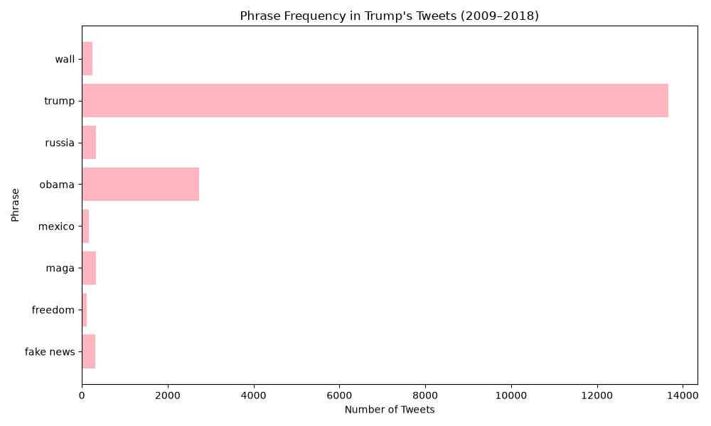

# [lab-web-data](https://csci40.rtealwitter.com/topics/05_web_scraping/lab.html)

For the web-data lab, I looked through 35402 tweets from President Trump's twitter archive from the years 2009 to 2018. Alongside the five required phrases, I have also chosen "wall", "freedom", and "MAGA" to see how often these words would pop up. I though "MAGA" would appear most compared to the others because it was his campaign slogan. I found it funny that his name appeared the most. Self-love or narcissism? 

| phrase            | percent of tweets |
| ----------------- | ----------------- |
|         fake news | 00.88             |
|           freedom | 00.30             |
|              maga | 00.93             |
|            mexico | 00.45             |
|             obama | 07.73             |
|            russia | 00.91             |
|             trump | 38.58             |
|              wall | 00.68             |

## Exposé 

## Discussion 

Out of all eight phrases, "Trump" appeared the most at a whopping 38.58% of the time. "MAGA" was actually his third most use word at 0.93% of the time, right below the name of his favorite person, "Obama." The word "wall" popped up 0.68% of the time, which makes sense because it is half-built. Lastly, "freedom" showed up 0.30% of the time. I suppose my prediction was correct that "MAGA" would show up the most in comparison to the other two, but it was not too wild of a guess, honestly. 